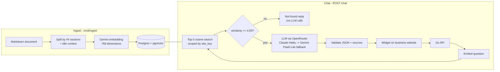
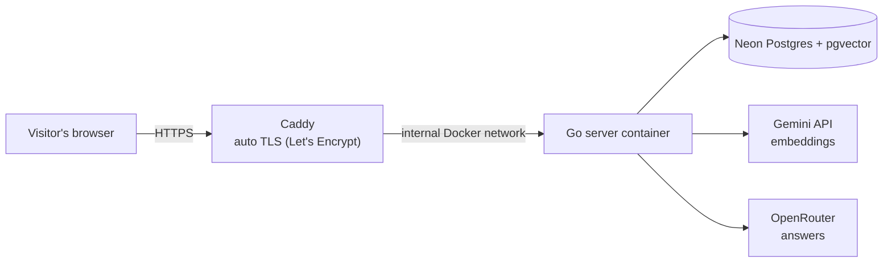

# AI CS Assistant

A customer-service chatbot that answers questions **only from a business's own documents** — and says "I don't know" instead of making things up.

**Live demo:** https://ai-cs.bytelab.my.id/demo.html
*(A fictional coffee shop, "Kedai Kopi Senja". Click the chat button in the bottom-right corner and ask about opening hours, prices, or how to order.)*

---

## Why

Small businesses get the same questions over and over: opening hours, prices, location, how to order. A generic chatbot can answer fluently, but it will happily **invent** a price or an opening time it doesn't know — and a confident wrong answer is worse than no answer for a business.

This project uses **RAG (Retrieval-Augmented Generation)**: for every question, it finds the relevant parts of the business's documents and lets the LLM answer **only** from them. If the answer isn't in the documents, the bot says so.

## Features

- **Grounded answers with sources** — every answer cites the document section it came from.
- **"I don't know" by design** — a two-layer answerability check prevents hallucinated answers.
- **Embeddable widget** — one `<script>` tag on any website; rendered in a Shadow DOM so the host site's CSS can't break it.
- **Multi-tenant ready** — each business has a `site_key`; retrieval is scoped so one business never gets another's data.
- **Resilient LLM calls** — automatic fallback between models, retries only on transient errors.
- **Abuse protection** — per-IP and global rate limiting to protect API credits.

## How it works



**Deployment**



Everything runs on a single VPS (Singapore) with Docker Compose. Only Caddy exposes ports to the internet; the Go server is reachable only through the internal Docker network.

## Tech stack

| Layer | Choice |
|---|---|
| Backend | Go 1.26, standard `net/http` router |
| Database | PostgreSQL + **pgvector** (Neon), HNSW cosine index, `pgx` / `pgxpool`, migrations with `goose` |
| Embeddings | Google Gemini `gemini-embedding-2` (768 dimensions) |
| Answers | OpenRouter: `anthropic/claude-haiku-5.5`, fallback `google/gemini-3.1-flash-lite` |
| Widget | Vanilla JavaScript, Shadow DOM, no dependencies |
| Infra | Docker (multi-stage build), Docker Compose, Caddy, Ubuntu 24.04 VPS |

## Design decisions

**1. Two layers decide whether a question is answerable.**
During testing, similarity scores alone couldn't separate answerable from unanswerable questions: *"Can I pay with crypto?"* (not in the docs) scored **0.583**, while *"What time do you close?"* (in the docs) scored **0.621**. A single threshold would be fragile. So:
- a **low threshold (0.50)** filters clearly irrelevant questions *before* calling the LLM (faster and free), and
- the **LLM decides** `answered: true/false` from the retrieved context, and must cite which context it used.
An answer marked "answered" **without a valid source** is treated as not found.

**2. Never trust LLM output blindly.**
Responses use strict JSON Schema structured output, and the code still validates defensively: it checks `finish_reason`, strips stray code fences, validates the JSON, drops unknown or duplicate source numbers, and retries once on transient failures. All text is rendered in the widget with `textContent` (never `innerHTML`) to prevent XSS from model output.

**3. Provider-agnostic interfaces.**
`Embedder` and `Generator` are separate Go interfaces. Gemini implements both; OpenRouter implements only `Generator`. When the direct Gemini generation endpoint kept returning `503` during development, switching answers to OpenRouter required no changes to the RAG logic.

**4. Retry only what can succeed on retry.**
`429` and `5xx` errors are retried; `400/401/403` are not, because repeating a bad request or an invalid key only wastes time and quota.

**5. Slow external calls stay outside database transactions.**
During ingest, all embeddings are computed *before* opening the transaction, so a slow or failing API call never holds a database connection. Request timeouts are derived from the client's request context: if a visitor closes the tab, in-flight LLM calls are cancelled and no credits are wasted.

**6. Chunk by meaning, not by size.**
Business documents are already organized by topic, so chunks follow Markdown `##` sections. Each chunk is prefixed with *"Business name - Section"*, so a chunk like `- Americano: Rp20.000` still matches a question about "the menu".

**7. Data quality beats prompt tweaking.**
An answer about ordering via *Gojek* was inconsistent between runs, because the document only said *GoFood*. Rewriting one sentence in the document — *"Gojek (GoFood) and Grab (GrabFood)"* — fixed it, with no code or prompt changes.

## Evaluation

10 test questions, phrased the way customers actually write (not copied from the document):

| | Result |
|---|---|
| Answerable (6) | **5 / 6** answered correctly |
| Not in the documents (4) | **4 / 4** correctly declined |
| Hallucinated answers | **0** |
| **Total** | **9 / 10** |

One of the "not in the documents" questions is a trap: *"How much is a cappuccino?"* retrieves the menu section, but cappuccino isn't on the menu. The bot declined instead of inventing a price.

**Known limitation:** *"Can I park a car?"* was declined even though the location section mentions limited car parking. The reply came from the system's own not-found path (not from the LLM), meaning the short question either scored below the similarity threshold or was answered without a valid source. The system is intentionally conservative: one missed answer is preferable to an invented one. Next step: add retrieval debug output and tune the threshold against a larger test set.

**Cost & latency:** about **$0.0001 per question** (≈800 input + ≈100 output tokens on Claude Haiku via OpenRouter), and roughly **1.5–4 s** per answer, dominated by the LLM call.

## Project structure

```
cmd/
  ingest/     # CLI: chunk + embed + store a Markdown document
  ask/        # CLI: ask a question from the terminal (dev & eval)
  server/     # HTTP server: POST /chat, GET /healthz, static widget files
internal/
  chunk/      # Markdown section chunking with overlap for long sections
  db/         # pgxpool connection with pgvector types registered
  llm/        # Embedder / Generator interfaces, Gemini + OpenAI-compatible providers
  rag/        # Retrieval, prompt building, answer validation
  ratelimit/  # Per-IP + global token-bucket rate limiting
db/migrations/  # goose SQL migrations
data/           # Demo business documents
web/            # widget.js + demo.html
```

## Running locally

**Requirements:** Go 1.26+, a Postgres database with pgvector (e.g. Neon), a Gemini API key, an OpenRouter API key.

```bash
# 1. Configure
cp .env.example .env    # fill in the values below
set -a; source .env; set +a

# 2. Create tables
go install github.com/pressly/goose/v3/cmd/goose@latest
goose -dir db/migrations postgres "$DATABASE_URL" up

# 3. Ingest the demo document
go run ./cmd/ingest -file data/kedai-kopi.md

# 4. Ask from the terminal...
go run ./cmd/ask -q "What time do you close?"

# ...or run the server and open http://localhost:8080/demo.html
go run ./cmd/server
```

**Environment variables**

| Variable | Example |
|---|---|
| `DATABASE_URL` | Postgres connection string (use a direct, non-pooled connection) |
| `GEMINI_API_KEY` | Google AI Studio key |
| `GEMINI_EMBED_MODEL` | `gemini-embedding-2` |
| `GEMINI_GEN_MODEL` | `gemini-3.1-flash-lite` |
| `OPENROUTER_BASE_URL` | `https://openrouter.ai/api/v1` |
| `OPENROUTER_API_KEY` | OpenRouter key |
| `OPENROUTER_MODELS` | `anthropic/claude-haiku-5.5,google/gemini-3.1-flash-lite` |
| `PORT` | `8080` (default) |
| `TRUST_PROXY` | `true` only when running behind a reverse proxy |

## Embedding the widget

```html
<script src="https://ai-cs.bytelab.my.id/widget.js"
        data-site-key="demo-kopi"
        data-title="Kedai Kopi Senja"></script>
```

## Roadmap

- [ ] Admin dashboard (React + TypeScript): upload documents, view conversations, review unanswered questions
- [ ] Conversation history
- [ ] Retrieval debug mode + larger evaluation set
- [ ] Automatic deploys from `main` with GitHub Actions
- [ ] Streaming answers

## License

MIT
